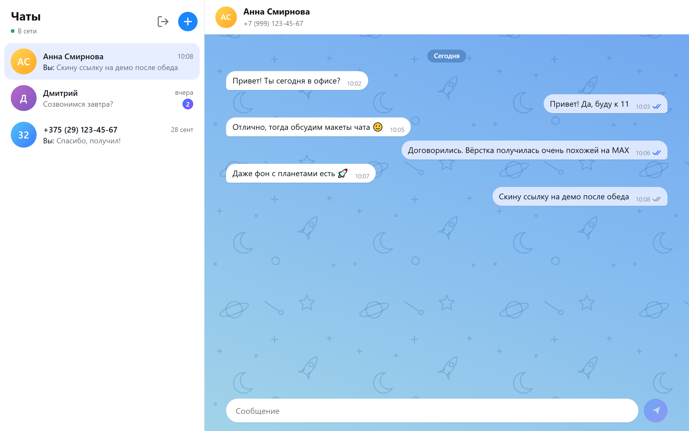
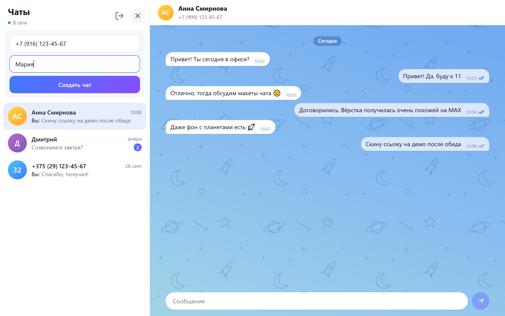
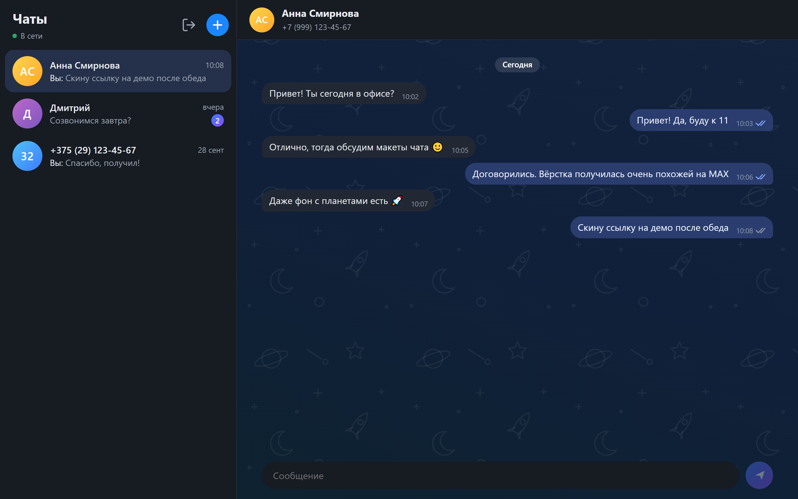
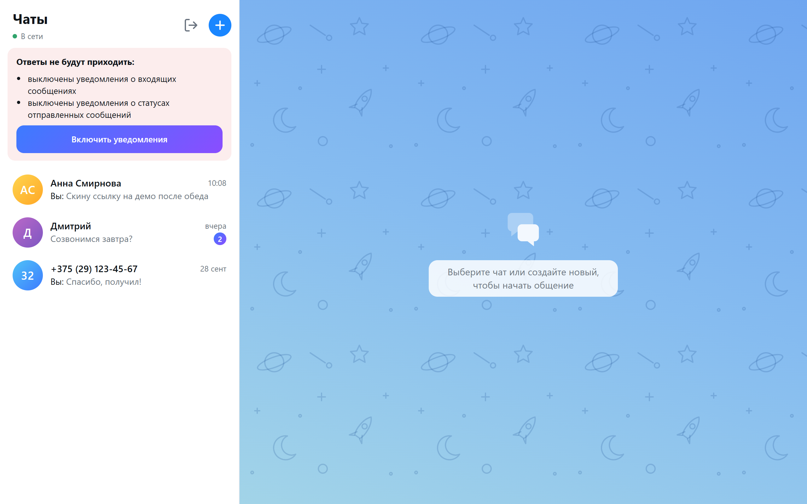

# MAX Chat — GREEN-API

Простой веб-интерфейс для отправки и получения текстовых сообщений в мессенджере **MAX** через сервис [GREEN-API](https://green-api.com/max). Внешний вид по мотивам [web.max.ru](https://web.max.ru/).

Та же программа работает и с **Telegram**-инстансом GREEN-API ([документация](https://green-api.com/telegram/docs/)): мессенджер выбирается переключателем на экране входа. API у GREEN-API для обоих мессенджеров одинаковое, отличаются только допустимые номера (MAX — РФ и РБ, Telegram — любые международные) и лимит длины сообщения (4000 и 4096 символов).

**Демо:** [https://hellishlovelace.github.io/green-api-task-test/](https://hellishlovelace.github.io/green-api-task-test/) — нужны свои `idInstance` и `apiTokenInstance`, они хранятся только в вашем браузере.

**Стек:** React 19 + TypeScript + Vite. Без UI-библиотек и без бэкенда: браузер ходит напрямую в GREEN-API.


## Сценарий

1. Пользователь выбирает мессенджер (MAX или Telegram) и вводит учётные данные GREEN-API: `idInstance`, `apiTokenInstance` (и `apiUrl`, который подставляется автоматически по первым 4 цифрам `idInstance`). При входе `getSettings` проверяет, что инстанс того мессенджера, который выбран (иначе приложение предложит войти с правильным), а `getStateInstance` — что инстанс авторизован.
2. Пользователь вводит номер телефона получателя и создаёт новый чат (кнопка «+»). 
3. Пользователь пишет сообщение и отправляет его (Enter — отправить, Shift+Enter — перенос строки).
4. Получатель отвечает в мессенджере.
5. Ответ появляется в чате.

## Скриншоты

| Вход | Переписка |
| --- | --- |
|  |  |
| **Новый чат: маска номера** | **Тёмная тема** |
|  |  |
| **Предупреждение о выключенных уведомлениях** | |
|  | |

Имена и номера на скриншотах вымышленные.

## Используемые методы API

| Задача | Метод | Документация |
| --- | --- | --- |
| Отправка текста | `POST sendMessage` | [SendMessage](https://green-api.com/v3/docs/api/sending/SendMessage/) |
| Получение уведомлений | `GET receiveNotification?receiveTimeout=20` → `DELETE deleteNotification/{receiptId}` | [HTTP API](https://green-api.com/v3/docs/api/receiving/technology-http-api/) |
| Проверка учётных данных при входе | `GET getStateInstance` | [GetStateInstance](https://green-api.com/v3/docs/api/account/GetStateInstance/) |
| `chatId` пользователя по номеру | `POST checkAccount` | [CheckAccount](https://green-api.com/v3/docs/api/service/CheckAccount/) |
| Тип инстанса при входе и проверка настроек уведомлений | `GET getSettings` | [GetSettings](https://green-api.com/v3/docs/api/account/GetSettings/) |
| Включение уведомлений по кнопке | `POST setSettings` | [SetSettings](https://green-api.com/v3/docs/api/account/SetSettings/) |
| Отметка «прочитано» для открытого чата | `POST readChat` | [ReadChat](https://green-api.com/v3/docs/api/marks/ReadChat/) |

### Почему используется CheckAccount

Входящие сообщения в MAX приходят с внутренним `chatId` пользователя (например, `"10000000"`), а не с номером телефона. Поэтому при создании чата номер сначала превращается в `chatId` через `checkAccount`, и ответы попадают в нужный чат. Если метод недоступен (например, из-за лимита 469 — после него номера 2 часа не проверяются), чат создаётся с `79991234567@c.us`: `sendMessage` принимает и такой формат. Когда придёт первый ответ, чат сопоставится по `senderPhoneNumber` и переключится на настоящий `chatId`.

## Запуск

```bash
npm install
npm run dev      # http://localhost:5173
npm run build    # production-сборка в dist/
npm test         # unit-тесты (vitest)
```

При пуше в `main` GitHub Actions (`.github/workflows/deploy.yml`) прогоняет тесты, собирает проект и публикует его на GitHub Pages.

## Настройка инстанса

- Инстанс должен быть авторизован в мессенджере ([личный кабинет](https://console.green-api.com)).
- Для получения сообщений через HTTP API поле **webhookUrl должно быть пустым**, а уведомления о входящих сообщениях (`incomingWebhook`) и статусах (`outgoingWebhook`) включены. У нового инстанса они бывают выключены: тогда после входа приложение покажет предупреждение с кнопкой «Включить уведомления» (`setSettings`, применяется в течение 5 минут).
- MAX через GREEN-API работает с номерами РФ (`7…`, 11 цифр) и РБ (`375…`, 12 цифр).
- В Telegram `checkAccount` возвращает `exist: false`, если номер скрыт настройками приватности получателя.

## Структура

```
src/
  App.tsx                     — корень: экран входа или мессенджер
  api/
    greenApi.ts               — клиент GREEN-API: запросы, ошибки, повтор при 429, поиск chatId по номеру
  model/
    chatStore.ts              — состояние чатов (редьюсер) и разбор уведомлений в действия
    messenger.ts              — различия MAX и Telegram: название, лимит длины, тексты
  hooks/
    useNotifications.ts       — цикл получения: receiveNotification → обработка → deleteNotification
    useMarkRead.ts            — readChat, когда пользователь видит новые входящие
  components/
    LoginScreen.tsx           — вход, проверка типа и состояния инстанса
    MessengerScreen.tsx       — основной экран: связывает состояние, получение и отправку
    Sidebar.tsx               — список чатов
    NewChatForm.tsx           — создание чата по номеру
    PhoneInput.tsx            — поле телефона с маской
    SettingsCheck.tsx         — предупреждение о выключенных уведомлениях
    ChatWindow.tsx            — лента сообщений и поле ввода
    Avatar.tsx, Icons.tsx
  utils/                      — телефон, время, localStorage
  styles/
    tokens.css                — цвета и размеры (CSS-переменные) для светлой и тёмной темы
    base.css                  — базовые стили и общие элементы: кнопки, поле ввода, спиннер
```

Стили компонентов лежат рядом с ними (`Sidebar.tsx` + `Sidebar.css`) и подключаются импортом из компонента; в `styles/` — только общее.

Также написал vitest, лежат в директории рядом. Благодаря ним покрываются состояния разбора уведомлений из GreenApi, тест маски телефона, проверка определения инстанса (MAX или Telegram).

